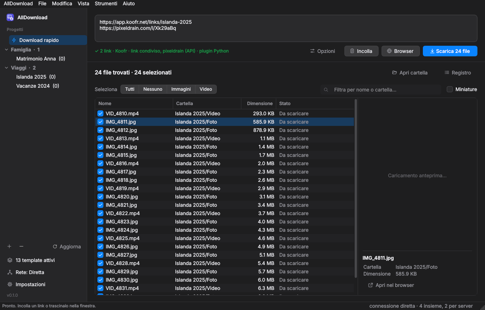

<p align="center">
  
</p>

<h1 align="center">AllDownload</h1>

<p align="center">
  Scarica foto e video da link condivisi e gallerie — su macOS, Windows e Linux.<br>
  Ogni sito supportato ha il suo plugin Python. Puoi anche aggiungere template <code>.etmpl</code> (formato di Extreme Picture Finder).
</p>

<p align="center">
  <a href="README.md">English</a> ·
  <a href="docs/guida-utente.md">Guida utente</a> ·
  <a href="docs/templates.md">Template</a> ·
  <a href="docs/building.md">Compilare</a> ·
  <a href="docs/troubleshooting.md">Problemi</a>
</p>



## Cosa fa

**Trovi e scegli**
- Incolli uno o più link. AllDownload trova foto e video, mostra l'anteprima, e tu spunti quelli che vuoi. Oppure scarichi tutto subito.
- I file compaiono uno alla volta mentre cerca, e ognuno può partire subito.
- Anteprime e miniature, anche dei video (miniature del sito o fotogramma con ffmpeg).

**Progetti**
- Link, cartella e opzioni si salvano come progetto, divisi per categoria.
- **Aggiorna** scarica solo i file nuovi. Più progetti in coda, con priorità alta, normale o bassa.
- Un progetto «osservato» si controlla da solo ogni 1, 6, 12 o 24 ore.

**Veloce, ma gentile con i server**
- Più download insieme, con un limite per server che si adatta (sale se il server risponde bene, si dimezza al «troppe richieste») e viene ricordato.
- File grandi a pezzi se il server lo permette; HTTP/2 dove c'è. Prima i file piccoli, server a turno.
- Le pause dei template valgono per server, e puoi accorciarle (Impostazioni → Download).
- Pausa e riprendi, anche dopo aver chiuso l'app. I file interrotti ripartono da dove erano.
- Se vuoi: orari, pausa a batteria, quota di banda, limite di velocità, contatore delle richieste per sito.

**File di cui fidarsi**
- Nome a modello, es. `{profilo}_{data}_{n}` → `mario_2026-03-14_0007.jpg`.
- Data del file = data del post (dalle API del sito) o quella del server; didascalia in un `.txt` accanto, se vuoi.
- Foto e video controllati alla fine: se sono a metà (o è arrivata una pagina web al posto del file) si riscaricano.
- Spazio su disco: avviso prima di partire e stop automatico prima di riempire il disco.
- Cartelle col nome dell'album (Bunkr, filester), divise in `Foto`, `Video` e `Altri`. Le chat vanno in `<utente>/Chat/`.
- I file già scaricati si saltano anche se il sito cambia il link; le foto uguali con un altro nome si segnalano o si spostano.

**Una vera app per Mac**
- Aspetto da Mac: barra laterale come nel Finder, il colore scelto in Impostazioni di Sistema, tema chiaro e scuro, menu Modifica (copia e incolla anche nel browser interno).
- Icona nella barra dei menu con avanzamento, pausa, ripresa e stop.
- **Aggiornamenti dall'app:** controlla GitHub una volta al giorno, ti mostra le novità, si installa con un clic (salva una copia, non tocca impostazioni e login) e si riavvia.
- Interfaccia in italiano e in inglese.

**Browser interno**
- Fai login, risolvi i controlli «sei umano?», poi continui: cookie e token passano al download.
- Registra le richieste alle API della pagina, così i template possono usarle.

**Strumenti**
- Editor dei template con prova dal vivo, statistiche, registro dettagliato, segnalibro «Manda ad AllDownload» ed estensione per Chrome.
- La tua lista di proxy (HTTP/SOCKS, liste tipo Webshare), provati e ordinati per velocità — non per OnlyFans/Fansly, vedi sotto.

## Siti supportati

| Servizio | Cosa | Stato (tutti plugin Python) |
|---|---|---|
| **Bunkr** | album e file singoli, foto e video | ✅ provato a novembre 2026 (link firmati; le foto degli album arrivano dall'elenco «gallery») |
| **filester** | cartelle, sottocartelle e file singoli | ✅ provato a novembre 2026 |
| **OnlyFans** | media del profilo **e** chat (foto e video sbloccati) | ✅ provato a novembre 2026 — leggi [come si usa](#onlyfans-e-fansly) |
| Fansly | media | solo il tuo account, da provare |
| **Koofr** | link condivisi (anche i link brevi `k00.fr`), con password | ✅ provato a novembre 2026 — la cartella prende il nome del link condiviso |
| **pixeldrain** | file e liste | ✅ provato a novembre 2026 (API) |
| **Gofile** | cartelle e sottocartelle | ✅ provato a novembre 2026 — usa il browser interno (accesso ospite) |
| ImageFap | gallerie, categorie | da provare |
| Tumblr | blog | da provare |
| **happymodal** | gallerie, elenchi di gallerie | ✅ provato a novembre 2026 |
| **blinkgirl** | articoli con galleria, elenchi | ✅ provato a novembre 2026 |
| jliji | set di foto, elenchi | da provare |
| **gedecomix** | fumetti, capitoli, elenchi | ✅ provato a novembre 2026 — pagine salvate come 001, 002, … |
| av01 | video singoli (HLS → .mp4, serve ffmpeg) | da provare — usa il browser interno; i video cifrati si saltano |
| X (Twitter) | profilo: media, post, risposte, repost | da provare — login col tuo account nel browser interno; foto originali, video nella qualità più alta |

L'app non include più template. Puoi sempre aggiungere i tuoi `.etmpl`: trascina il file nella finestra. La compatibilità viene controllata per ogni template (vedi [Template](docs/templates.md)); se aggiungi due versioni dello stesso template, vince la più nuova. Un plugin Python per lo stesso sito passa davanti. Per scrivere un plugin: [docs/plugins.md](docs/plugins.md).

## OnlyFans e Fansly

1. Incolla il link di un profilo (`onlyfans.com/<nome>/media`) o di una chat (`onlyfans.com/my/chats/chat/<id>`).
2. Si apre il browser interno. La prima volta fai login; poi aspetta che si vedano i contenuti e premi **Continua download**. Il login resta salvato.
3. Scegli i file (o scarica tutto). Le chat finiscono in `<utente>/Chat/Foto|Video`.

Importante:
- **Niente proxy.** I link dei file valgono solo per l'indirizzo IP del browser interno: con i proxy arrivano errori e timeout. AllDownload te lo dice e può disattivarli per te.
- **VPN:** va bene, ma scegli un server e **non cambiarlo** durante ricerca e download — e non cambiarlo spesso, se no il sito può chiederti di nuovo il login.
- Solo il tuo account e i contenuti che il tuo abbonamento ti dà già. I flussi protetti da DRM non si scaricano.

## Installare e avviare

**App pronta:** scarica `AllDownload-mac.zip` (Apple Silicon) o `AllDownload-windows.zip` dall'ultima [Release](../../releases). Su Mac l'app non è firmata da Apple: la prima volta tasto destro → **Apri**.

**Dal codice:** serve **Python 3.10–3.13**. **ffmpeg** è facoltativo (fotogrammi dei video e video HLS).

```bash
git clone https://github.com/m4st3r-0day/alldownload.git
cd alldownload
python3 -m venv .venv && source .venv/bin/activate      # Windows: .venv\Scripts\activate
pip install -e .
python -m picfinder                                     # apre la finestra
```

**Creare l'app per Mac da solo:** `packaging/build_mac.sh` crea `AllDownload.app` e la mette in Applicazioni. Vedi [Compilare](docs/building.md).

## Aggiornamenti e nuove versioni

- L'app controlla una volta al giorno se c'è una versione nuova (o *AllDownload → Controlla aggiornamenti…*), mostra le novità e si installa quando vuoi. Una copia dei file sostituiti va in `backup/`.
- Il token GitHub non serve più (il repo è pubblico). Se GitHub dice «troppe richieste», puoi metterne uno di sola lettura in *Impostazioni → Generale → Aggiornamenti*.
- Per pubblicare una versione: scrivi le novità sotto `## [Unreleased]` in [CHANGELOG.md](CHANGELOG.md) e avvia **Pubblica nuova versione.command**. Cambia il numero, crea il tag e carica; poi GitHub Actions crea le app per Mac e Windows con `SHA256SUMS` (le istruzioni stanno in `packaging/github-release.yml`).

**Da riga di comando:**

```bash
python -m picfinder <link> -o Cartella      # scarica dal Terminale
python -m picfinder --template              # template e compatibilità
python -m picfinder --progetti              # progetti salvati
python -m picfinder --aggiorna "Nome"       # aggiorna un progetto o una categoria
```

## Uso responsabile

AllDownload è un gestore di download. Usalo solo per contenuti che puoi scaricare, e rispetta le regole di ogni sito.

- **Non** aggira DRM né flussi cifrati.
- **Non** si traveste per evitare i blocchi: niente proxy che girano per superare i limiti, niente impronte del browser finte.
- Rallenta quando un sito lo chiede.
- I siti con account (OnlyFans, Fansly) funzionano solo col tuo login e con i contenuti che il tuo abbonamento ti dà già.

AllDownload non è collegato a Extreme Picture Finder né ai siti elencati. I marchi appartengono ai rispettivi proprietari.

### Avvertenze

AllDownload è pensato per **uso personale**: salvare i tuoi file, o contenuti che hai il diritto di scaricare (per esempio condivisi con te dal proprietario, o compresi nel tuo abbonamento).
Sei tu responsabile di come lo usi. Rispetta il diritto d'autore, le regole dei siti che usi e la privacy degli altri.
L'autore non è responsabile per usi impropri. Il programma è fornito «così com'è», senza garanzie.

## Documentazione

- [Guida utente](docs/guida-utente.md) · [User guide (EN)](docs/user-guide.md)
- [Template (.etmpl)](docs/templates.md)
- [Architettura](docs/architecture.md)
- [Compilare e sviluppare](docs/building.md)
- [Problemi e soluzioni](docs/troubleshooting.md)
- [Roadmap](ROADMAP.md) · [Novità](CHANGELOG.md) · [Contribuire](CONTRIBUTING.md) · [Sicurezza](SECURITY.md)

## Licenza

[MIT](LICENSE). Le parti di altri hanno la loro licenza: Qt for Python (PySide6) è LGPL-3.0, httpx e le sue dipendenze sono BSD/MIT. I template `.etmpl` che aggiungi appartengono ai loro autori.
