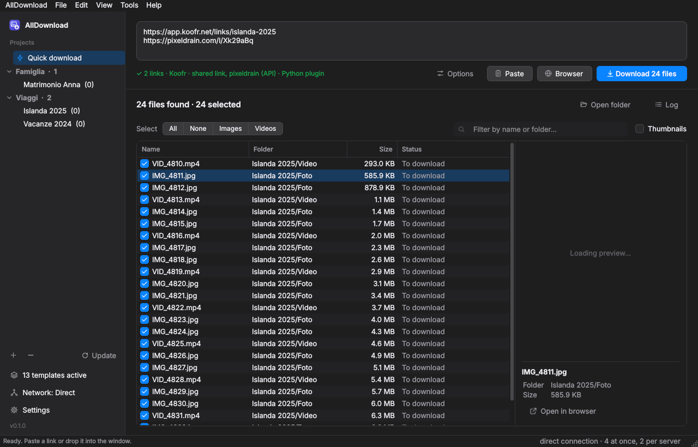

  

<h1 align="center">AllDownload</h1>

  Download photos and videos from shared links and galleries — on macOS, Windows and Linux. 
  Every supported site has its own Python plugin. You can also add <code>.etmpl</code> templates (Extreme Picture Finder format).

  <a href="README.it.md">Italiano</a> ·
  <a href="docs/user-guide.md">User guide</a> ·
  <a href="docs/templates.md">Templates</a> ·
  <a href="docs/building.md">Build</a> ·
  <a href="docs/troubleshooting.md">Troubleshooting</a>

## Features

**Find and choose**
- Paste one or more links: AllDownload finds every photo and video, shows a preview, and you tick what you want — or download everything right away.
- Files appear one by one while the search is still running, and each one can start downloading straight away.
- Previews and thumbnails, video frames included (site thumbnails or ffmpeg).

**Projects**
- Save links, folder and options as a project, grouped by category.
- **Update** downloads only the new files. Queue several projects with high, normal or low priority.
- Watched projects are checked automatically every 1, 6, 12 or 24 hours.

**Fast, but polite to servers**
- Parallel downloads with a per-server limit that adapts (grows while a server answers well, halves on "too many requests") and is remembered.
- Large files in parallel parts when the server supports it; HTTP/2 where available. Small files first, servers take turns.
- Template pauses apply per server, and you can shorten them (Settings → Download).
- Pause and resume, even after closing the app. Interrupted files continue where they stopped.
- Optional download hours, pause on battery, bandwidth share, speed limit, daily request counter per site.

**Files you can trust**
- Name pattern, e.g. `{profilo}_{data}_{n}` → `mario_2026-03-14_0007.jpg`.
- The file date is the post date (from the site's API) or the server's; optional caption saved next to the file.
- Photos and videos are checked when they finish: truncated files (or an HTML page instead of the file) are downloaded again.
- Disk space: a warning before starting, and an automatic stop before the disk fills up.
- Folders named after the album (Bunkr, filester), split into `Foto`, `Video` and `Altri`. Chats go to `<user>/Chat/`.
- Files you already downloaded are skipped even when the site re-signs the link; identical photos with another name can be flagged or moved aside.

**A real Mac app**
- Native look: Finder-style sidebar, your system accent colour, light and dark theme, Edit menu (copy/paste also inside the built-in browser).
- Menu bar icon with progress, pause, resume and stop.
- **Updates from the app:** it checks GitHub once a day, shows what's new, installs with one click (keeps a backup, never touches your settings or logins) and restarts.
- English and Italian interface.

**Built-in browser**
- Sign in, solve "are you human?" checks, then continue: cookies and tokens go to the downloader.
- Captures the API requests a page makes, so templates can use them.

**Tools**
- Template editor with a live test, statistics, a detailed log, a "Send to AllDownload" bookmarklet and a Chrome extension.
- Your own proxy list (HTTP/SOCKS, Webshare-style lists), tested and sorted by speed — not for OnlyFans/Fansly, see below.

## Supported sites

| Service | What | Status (all Python plugins) |
|---|---|---|
| **Bunkr** | albums and single files, photos and videos | ✅ tested Nov 2026 (signed download links; album photos come from the gallery list) |
| **filester** | folders, subfolders and single files | new plugin, to be retested |
| **OnlyFans** | profile media **and** chats (unlocked photos and videos) | new plugin, to be retested — read [how to use it](#onlyfans-and-fansly) |
| Fansly | media | your own account, to be tested |
| **Koofr** | shared links (also `k00.fr` short links), with password | ✅ tested Nov 2026 — the folder takes the shared link's name |
| pixeldrain | files and lists | API, to be tested |
| **Gofile** | folders and subfolders | ✅ tested Nov 2026 — uses the built-in browser (guest access) |
| ImageFap | galleries, categories | to be tested |
| Tumblr | blogs | to be tested |
| **happymodal** | galleries, gallery lists | ✅ tested Nov 2026 |
| **blinkgirl** | gallery posts, lists | ✅ tested Nov 2026 |
| jliji | photo sets, lists | to be tested |
| **gedecomix** | comics, chapters, lists | ✅ tested Nov 2026 — pages saved as 001, 002, … |
| av01 | single videos (HLS → .mp4, needs ffmpeg) | to be tested — uses the built-in browser; encrypted videos are skipped |
| X (Twitter) | profile media, posts, replies, reposts | to be tested — log in with your own account in the built-in browser; original-size photos, best-quality videos |

No templates are bundled any more. You can still add your own `.etmpl` templates: drag the file onto the window. Compatibility is checked for every template (see [Templates](docs/templates.md)); if you add two versions of the same template, the newer one is used. A Python plugin for the same site comes first. To write a plugin, see [docs/plugins.md](docs/plugins.md).

## OnlyFans and Fansly

1. Paste the link of a profile (`onlyfans.com/<name>/media`) or of a chat (`onlyfans.com/my/chats/chat/<id>`).
2. The built-in browser opens. The first time, log in; then wait until the content is visible and press **Continue download**. Your login is remembered.
3. Choose the files (or download everything). Chats are saved in `<user>/Chat/Foto|Video`.

Important:
- **Don't use proxies.** File links only work for the IP address of the built-in browser: with proxies you get errors and timeouts. AllDownload warns you and can turn them off for you.
- **VPN:** fine, but pick one server and **don't change it** during search and download — and not too often, or the site may ask you to log in again.
- Only your own account and the content your subscription already gives you. Streams protected by DRM are not downloaded.

## Responsible use

AllDownload is a download manager. Use it only for content you are allowed to download, and follow each site's terms.

- It does **not** bypass DRM or encrypted streams.
- It does **not** disguise itself to evade bans: no rotating proxies to dodge limits, no fake browser fingerprints.
- It slows down when a site asks it to.
- Account-based sites (OnlyFans, Fansly) only work with your own login and the content your subscription already gives you.

AllDownload is not affiliated with Extreme Picture Finder or any of the sites above. All trademarks belong to their owners.

### Disclaimer

AllDownload is meant for **personal use**: saving your own files, or content you have the right to download (for example shared with you by the owner, or included in your subscription).
You are responsible for how you use it. Respect copyright, the terms of the sites you use, and other people's privacy.
The author is not responsible for misuse. The software is provided "as is", without warranty of any kind.

## Documentation

- [User guide](docs/user-guide.md) · [Guida utente (IT)](docs/guida-utente.md)
- [Templates (.etmpl) support](docs/templates.md)
- [Architecture](docs/architecture.md)
- [Building and development](docs/building.md)
- [Troubleshooting](docs/troubleshooting.md)
- [Roadmap](ROADMAP.md) · [Changelog](CHANGELOG.md) · [Contributing](CONTRIBUTING.md) · [Security](SECURITY.md)

## License

[MIT](LICENSE). Third-party parts keep their own licenses: Qt for Python (PySide6) is LGPL-3.0, httpx and its dependencies are BSD/MIT. `.etmpl` templates you add belong to their authors.
